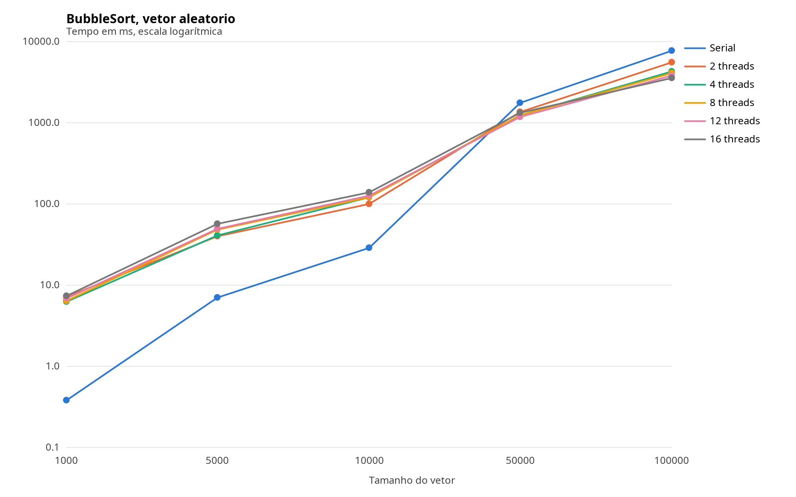
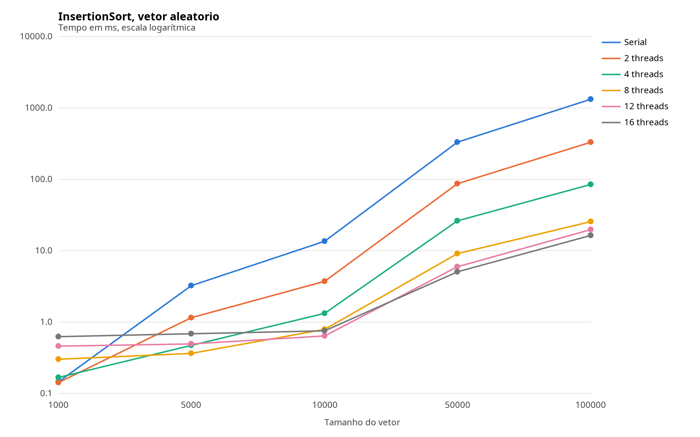
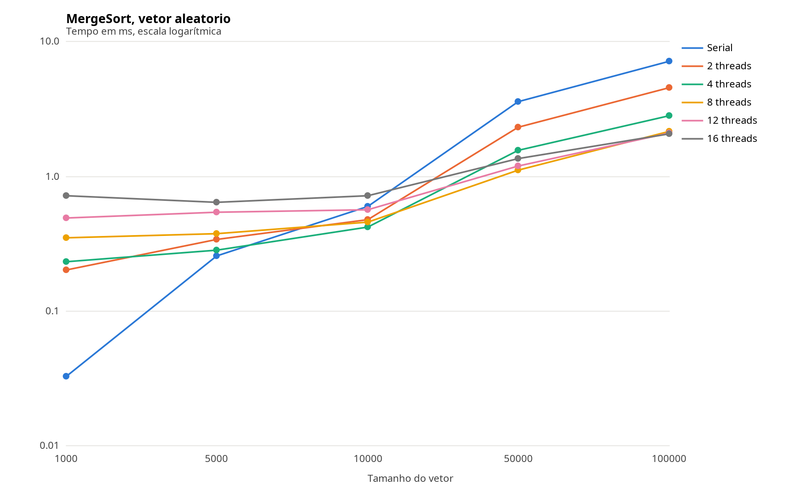
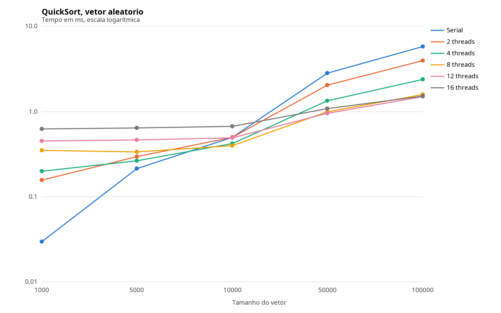
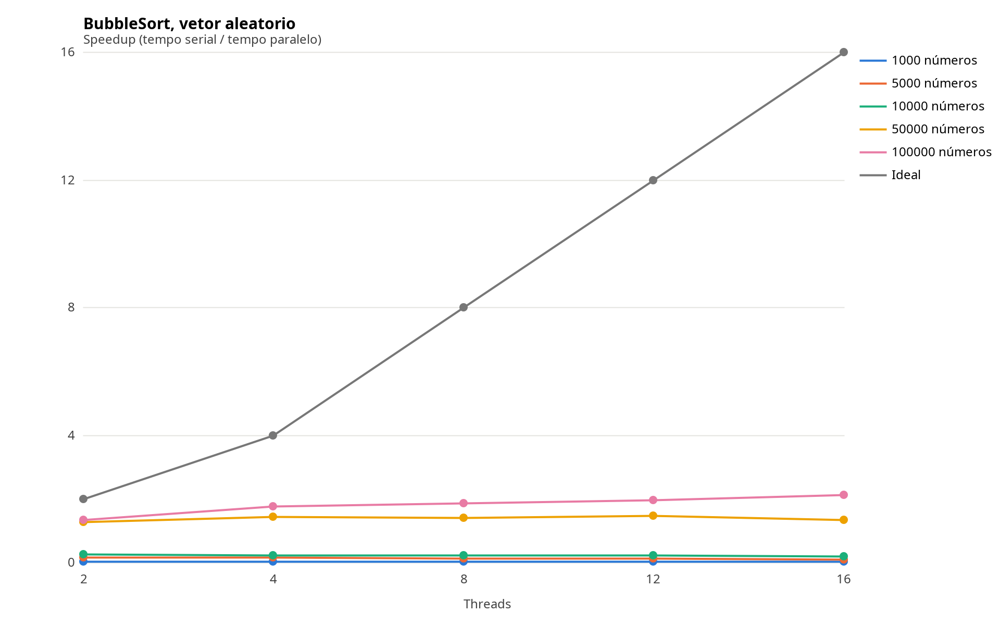
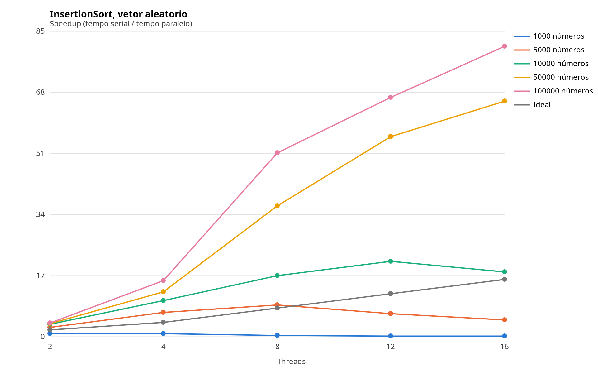
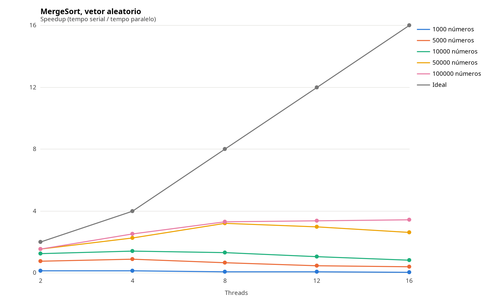
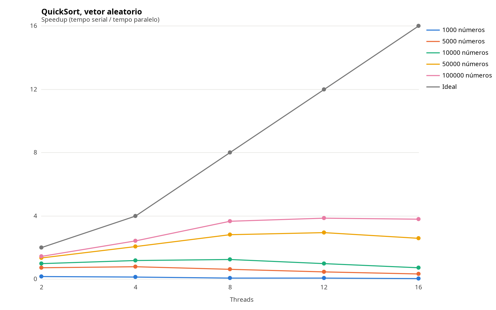
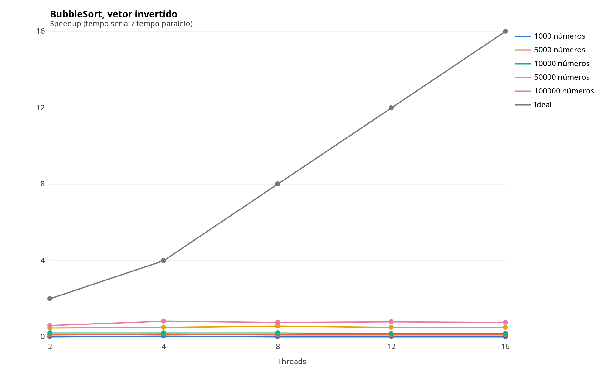
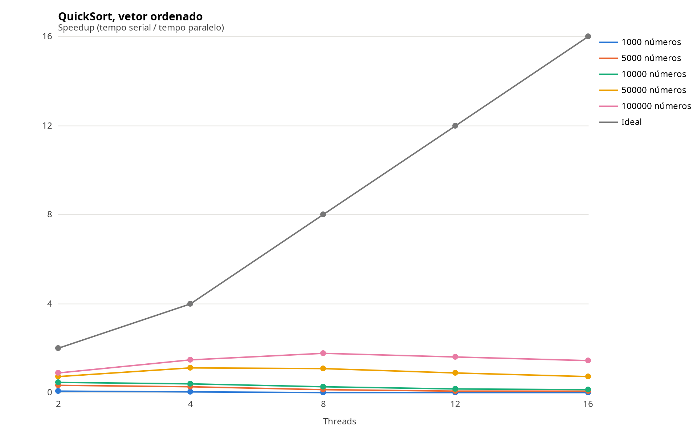

UNIVERSIDADE DE FORTALEZA 
CENTRO DE CIÊNCIAS TECNOLÓGICAS 
CURSO: CIÊNCIA DA COMPUTAÇÃO

# Pesquisa de algoritmos de ordenação seriais e paralelos

Autor 1: Paulo Shizuo Vasconcelos Tatibana

Autor 2: Gustavo Chaves Macedo

Palavras-chave: Algoritmos de ordenação. Programação paralela. Java. Speedup. Análise de desempenho.

## Resumo

Este trabalho compara Bubble Sort, Insertion Sort, Merge Sort e Quick Sort em versões serial e paralela, implementadas em Java, em 2.400 medições com vetores de 1.000 a 100.000 elementos, quatro tipos de dados e até 16 threads. Com 100.000 números aleatórios, o Merge Sort paralelo foi 3,46x mais rápido que o serial, e o Quick Sort, 3,87x. Com vetores já ordenados, a versão paralela perdeu para a serial no Bubble Sort e no Insertion Sort, mas continuou mais rápida no Merge Sort e no Quick Sort. O Insertion Sort chegou a 80,98 vezes, mas a maior parte disso vem da divisão do vetor em pedaços: as threads contribuíram com cerca de 5,8 vezes. No Merge Sort e no Quick Sort, o ganho parou de crescer a partir de 8 threads. O algoritmo pesou mais que o número de threads: o Quick Sort serial foi mais de 600 vezes mais rápido que o Bubble Sort com 16 threads.

## Introdução

Ordenação é uma operação comum em computação, e os processadores atuais têm vários núcleos, então executar em paralelo parece um caminho direto para reduzir o tempo. Porém, criar e coordenar threads tem custo, e a parte do trabalho que continua serial limita a redução possível (AMDAHL, 1967). Este trabalho mede esse efeito em Java, comparando versões serial e paralela de algoritmos de ordenação.

Dos seis algoritmos propostos, foram escolhidos quatro: Bubble Sort e Insertion Sort, de custo quadrático, e Mergesort e Quicksort, de custo médio O(n log n) (CORMEN et al., 2012; HOARE, 1962). Assim é possível comparar dois grupos de complexidade diferente e duas estratégias de paralelização.

O Merge Sort e o Quicksort dividem o problema de forma recursiva e foram paralelizados com o framework ForkJoin, que distribui as subtarefas entre as threads (LEA, 2000; ORACLE, 2026). O Bubble Sort foi paralelizado pelo método Odd-Even Transposition (HABERMANN, 1972), que alterna fases de comparação em posições pares e ímpares. Como os pares comparados em uma fase não se sobrepõem, as threads atuam ao mesmo tempo sem conflito. O Insertion Sort usa um pool fixo de threads (GOETZ et al., 2006): cada thread ordena um pedaço do vetor, e os pedaços são unidos em seguida com a operação de junção do Merge Sort.

A abordagem foi experimental: um único programa executa todas as combinações de algoritmo, tamanho, tipo de dado e número de threads e registra os tempos em CSV, usados depois nos gráficos.

## Metodologia

Pesquisa Descritiva.

Os algoritmos foram implementados em Java, nas classes Serial e Paralelo. A classe Main é o framework de teste: gera os vetores, executa todas as combinações, confere se cada vetor ficou ordenado e grava os tempos em resultados.csv. A classe Graficos lê esse arquivo e mostra gráficos interativos em Java Swing, que se atualizam enquanto o teste roda.

Os testes combinaram cinco tamanhos de vetor (1.000, 5.000, 10.000, 50.000 e 100.000), quatro tipos de dados (aleatório, ordenado, invertido e com todos os valores iguais) e seis modos de execução (serial e paralelo com 2, 4, 8, 12 e 16 threads). Cada combinação foi repetida cinco vezes, em um total de 2.400 medições. Os dados aleatórios usam semente fixa, então todos os algoritmos ordenam os mesmos vetores.

Tudo rodou em um único computador, com processador AMD Ryzen 7 5700X (8 núcleos e 16 threads lógicas), 31,3 GB de memória, Linux (CachyOS) e OpenJDK 21. O número de núcleos foi aproximado pelo número de threads: o sistema operacional não restringiu os núcleos disponíveis, e a configuração com 16 threads ocupa todas as threads lógicas do processador.

O tempo foi medido com System.nanoTime e cobre a ordenação de uma cópia do vetor e, nas versões paralelas, também a criação do pool de threads. Antes das medições, cada algoritmo rodou 20 vezes com vetores de 5.000 elementos, e esses resultados foram descartados, porque a JVM otimiza o código durante a execução e distorceria as primeiras medições (GEORGES; BUYTAERT; EECKHOUT, 2007).

Na análise estatística, a mediana foi usada como medida principal, por ser menos sensível a amostras discrepantes. Também foram calculados a média, o desvio padrão amostral, o coeficiente de variação (CV) e o intervalo de confiança de 95% pela distribuição t de Student com 4 graus de liberdade (t = 2,776). O ganho foi medido pelo speedup (S = tempo serial / tempo paralelo) e pela eficiência (E = S / número de threads). Duas configurações foram consideradas diferentes quando seus intervalos de confiança não se sobrepõem.

## Resultados e Discussão

Os quatro algoritmos rodaram com vetores de 1.000 a 100.000 elementos e quatro tipos de dados, primeiro na versão serial e depois na paralela com 2, 4, 8, 12 e 16 threads, com cinco amostras por configuração. A Tabela 1 resume os testes. As Tabelas 2 a 6 trazem os tempos com dados aleatórios, a Tabela 7 traz as estatísticas, a Tabela 8 mostra o ganho por tipo de dado e a Tabela 9 indica a partir de que tamanho o paralelo foi mais rápido que o serial. As Figuras 1 a 10 vêm do programa Gráficos, em Java Swing, a partir do arquivo resultados.csv.

Nas Tabelas 2 a 6, os tempos estão em milissegundos (ms) e são a mediana de cinco amostras com dados aleatórios. Cores: azul = serial; verde = paralelo mais rápido que o serial; vermelho = paralelo mais lento que o serial.

**Tabela 1: Configuração dos testes**

| Algoritmo | Paralelização | Vetores | Threads |
| --- | --- | --- | --- |
| BubbleSort | ThreadPool (Odd-Even) | 1.000, 5.000, 10.000, 50.000, 100.000 | Serial, 2, 4, 8, 12, 16 |
| InsertionSort | ThreadPool (pedaços + merge) | 1.000, 5.000, 10.000, 50.000, 100.000 | Serial, 2, 4, 8, 12, 16 |
| MergeSort | ForkJoin | 1.000, 5.000, 10.000, 50.000, 100.000 | Serial, 2, 4, 8, 12, 16 |
| QuickSort | ForkJoin | 1.000, 5.000, 10.000, 50.000, 100.000 | Serial, 2, 4, 8, 12, 16 |

**Tabela 2: Tempos com o vetor de 1.000 números (ms)**

| Algoritmo | Serial | 2 threads | 4 threads | 8 threads | 12 threads | 16 threads |
| --- | --- | --- | --- | --- | --- | --- |
| BubbleSort | 🟦 0,39 | 🟥 7,30 | 🟥 6,37 | 🟥 6,48 | 🟥 6,95 | 🟥 7,39 |
| InsertionSort | 🟦 0,15 | 🟩 0,14 | 🟥 0,17 | 🟥 0,31 | 🟥 0,46 | 🟥 0,63 |
| MergeSort | 🟦 0,03 | 🟥 0,20 | 🟥 0,23 | 🟥 0,35 | 🟥 0,50 | 🟥 0,72 |
| QuickSort | 🟦 0,03 | 🟥 0,16 | 🟥 0,20 | 🟥 0,35 | 🟥 0,45 | 🟥 0,63 |

**Tabela 3: Tempos com o vetor de 5.000 números (ms)**

| Algoritmo | Serial | 2 threads | 4 threads | 8 threads | 12 threads | 16 threads |
| --- | --- | --- | --- | --- | --- | --- |
| BubbleSort | 🟦 7,10 | 🟥 40,84 | 🟥 41,26 | 🟥 48,99 | 🟥 50,37 | 🟥 57,73 |
| InsertionSort | 🟦 3,24 | 🟩 1,17 | 🟩 0,47 | 🟩 0,37 | 🟩 0,50 | 🟩 0,69 |
| MergeSort | 🟦 0,26 | 🟥 0,34 | 🟥 0,28 | 🟥 0,38 | 🟥 0,55 | 🟥 0,65 |
| QuickSort | 🟦 0,21 | 🟥 0,30 | 🟥 0,27 | 🟥 0,34 | 🟥 0,46 | 🟥 0,64 |

**Tabela 4: Tempos com o vetor de 10.000 números (ms)**

| Algoritmo | Serial | 2 threads | 4 threads | 8 threads | 12 threads | 16 threads |
| --- | --- | --- | --- | --- | --- | --- |
| BubbleSort | 🟦 29,10 | 🟥 101,08 | 🟥 120,71 | 🟥 123,22 | 🟥 127,25 | 🟥 138,97 |
| InsertionSort | 🟦 13,70 | 🟩 3,79 | 🟩 1,34 | 🟩 0,80 | 🟩 0,65 | 🟩 0,76 |
| MergeSort | 🟦 0,60 | 🟩 0,48 | 🟩 0,42 | 🟩 0,46 | 🟩 0,57 | 🟥 0,72 |
| QuickSort | 🟦 0,50 | 🟥 0,50 | 🟩 0,42 | 🟩 0,40 | 🟩 0,49 | 🟥 0,67 |

**Tabela 5: Tempos com o vetor de 50.000 números (ms)**

| Algoritmo | Serial | 2 threads | 4 threads | 8 threads | 12 threads | 16 threads |
| --- | --- | --- | --- | --- | --- | --- |
| BubbleSort | 🟦 1.779,12 | 🟩 1.372,59 | 🟩 1.237,62 | 🟩 1.244,16 | 🟩 1.197,02 | 🟩 1.328,19 |
| InsertionSort | 🟦 334,35 | 🟩 88,69 | 🟩 26,67 | 🟩 9,16 | 🟩 6,00 | 🟩 5,09 |
| MergeSort | 🟦 3,58 | 🟩 2,31 | 🟩 1,57 | 🟩 1,12 | 🟩 1,20 | 🟩 1,37 |
| QuickSort | 🟦 2,82 | 🟩 2,06 | 🟩 1,35 | 🟩 0,99 | 🟩 0,95 | 🟩 1,09 |

**Tabela 6: Tempos com o vetor de 100.000 números (ms)**

| Algoritmo | Serial | 2 threads | 4 threads | 8 threads | 12 threads | 16 threads |
| --- | --- | --- | --- | --- | --- | --- |
| BubbleSort | 🟦 7.743,56 | 🟩 5.647,47 | 🟩 4.335,85 | 🟩 4.154,19 | 🟩 3.887,82 | 🟩 3.602,66 |
| InsertionSort | 🟦 1.328,89 | 🟩 333,17 | 🟩 84,97 | 🟩 25,91 | 🟩 19,91 | 🟩 16,41 |
| MergeSort | 🟦 7,18 | 🟩 4,59 | 🟩 2,85 | 🟩 2,16 | 🟩 2,12 | 🟩 2,08 |
| QuickSort | 🟦 5,82 | 🟩 3,98 | 🟩 2,40 | 🟩 1,59 | 🟩 1,51 | 🟩 1,53 |

**Tabela 7: Estatísticas com 100.000 números aleatórios (ms)**

| Algoritmo | Modo | Média | Desvio padrão | CV (%) | IC 95% |
| --- | --- | --- | --- | --- | --- |
| BubbleSort | Serial | 7.718,63 | 55,39 | 0,7 | ± 68,77 |
| BubbleSort | 16 threads | 3.571,96 | 115,97 | 3,2 | ± 143,97 |
| InsertionSort | Serial | 1.328,45 | 16,71 | 1,3 | ± 20,75 |
| InsertionSort | 16 threads | 15,96 | 1,11 | 7,0 | ± 1,38 |
| MergeSort | Serial | 7,26 | 0,13 | 1,9 | ± 0,17 |
| MergeSort | 16 threads | 2,14 | 0,16 | 7,5 | ± 0,20 |
| QuickSort | Serial | 5,82 | 0,02 | 0,3 | ± 0,02 |
| QuickSort | 16 threads | 1,52 | 0,03 | 2,1 | ± 0,04 |

**Tabela 8: Melhor speedup com 100.000 números (número de threads entre parênteses)**

| Algoritmo | Aleatório | Ordenado | Invertido | Igual |
| --- | --- | --- | --- | --- |
| BubbleSort | 🟩 2,15 (16) | 🟥 0,26 (2) | 🟥 0,84 (4) | 🟥 0,25 (2) |
| InsertionSort | 🟩 80,98 (16) | 🟥 0,34 (2) | 🟩 97,65 (16) | 🟥 0,34 (2) |
| MergeSort | 🟩 3,46 (16) | 🟩 1,77 (8) | 🟩 1,87 (8) | 🟩 1,91 (8) |
| QuickSort | 🟩 3,87 (12) | 🟩 1,77 (8) | 🟩 1,64 (8) | 🟩 1,64 (8) |

**Tabela 9: Menor vetor a partir do qual o paralelo compensou**

| Algoritmo | Aleatório | Ordenado | Invertido | Igual |
| --- | --- | --- | --- | --- |
| BubbleSort | 50.000 | Não compensou | Não compensou | Não compensou |
| InsertionSort | 1.000 | Não compensou | 1.000 | Não compensou |
| MergeSort | 10.000 | 50.000 | 50.000 | 50.000 |
| QuickSort | 10.000 | 50.000 | 50.000 | 50.000 |

Nos vetores de até 5.000 números aleatórios, as versões paralelas do Bubble Sort, do Merge Sort e do Quick Sort foram mais lentas que as seriais (Tabelas 2 e 3). Nesses casos, o custo de criar o pool de threads e de coordenar as tarefas foi maior que o tempo da própria ordenação. Com 1.000 números, por exemplo, o Merge Sort serial levou 0,03 ms, enquanto a melhor versão paralela levou 0,20 ms. O Merge Sort e o Quick Sort passaram a ser mais rápidos no paralelo a partir de 10.000 números, e o Bubble Sort, a partir de 50.000. O Insertion Sort paralelo foi mais rápido em todos os tamanhos, embora com 1.000 números a diferença tenha sido mínima (0,14 ms contra 0,15 ms). A partir de 50.000 números, as quatro versões paralelas foram mais rápidas que as seriais com dados aleatórios (Tabelas 4 a 6 e Figuras 1 a 4).

O tempo serial cresceu de forma compatível com a teoria. De 10.000 para 100.000 números aleatórios, o expoente de crescimento medido (inclinação em escala log-log) foi de 2,43 no Bubble Sort e 1,99 no Insertion Sort, próximos de O(n²), e de 1,08 no Merge Sort e 1,07 no Quick Sort, compatível com O(n log n). O expoente do Bubble Sort ficou acima de 2, o que indica um custo extra nos vetores maiores além do número de comparações, cuja causa não foi investigada. Com 100.000 números, o Bubble Sort serial levou 7.743,56 ms e o Quick Sort serial, 5,82 ms, mais de 1.300 vezes menos. Nem com 16 threads o Bubble Sort (3.602,66 ms) chegou perto: o Quick Sort serial ainda foi mais de 600 vezes mais rápido.

**Figura 1: Tempo x tamanho do Bubble Sort com dados aleatórios**

**Figura 2: Tempo x tamanho do Insertion Sort com dados aleatórios**

**Figura 3: Tempo x tamanho do Merge Sort com dados aleatórios**

**Figura 4: Tempo x tamanho do Quick Sort com dados aleatórios**

O Insertion Sort foi o algoritmo que mais se beneficiou do paralelismo. Com 100.000 números aleatórios, o tempo caiu de 1.328,89 ms no serial para 16,41 ms com 16 threads, cerca de 81 vezes menos, com eficiência de 5,06. O ganho passa do número de threads porque o custo do algoritmo cresce com o quadrado do tamanho da entrada: ordenar pedaços e juntá-los dá muito menos trabalho que ordenar o vetor inteiro. Por isso, a divisão em pedaços explica mais do ganho do que as threads. Um teste complementar, feito fora do framework com a mesma lógica de divisão, separou os dois efeitos: com 16 pedaços em uma única thread, o tempo foi de 93,25 ms, contra 1.278,13 ms do serial puro, e com 16 threads caiu para 15,99 ms. A divisão reduziu o tempo em 13,7 vezes, e as threads, em mais 5,8 vezes.

O Bubble Sort paralelo, implementado com o método Odd-Even Transposition, só superou o serial a partir de 50.000 números e chegou a ser 2,15 vezes mais rápido com 100.000 números aleatórios, com eficiência de 0,13. O ganho é limitado porque o algoritmo executa milhares de fases, e cada fase precisa esperar que todas as threads terminem antes de a próxima começar. Com 100.000 números aleatórios, as medições do Bubble Sort foram estáveis em todas as configurações, com coeficiente de variação entre 0,6% e 5,1%.

O Merge Sort e o Quick Sort, implementados com ForkJoin, foram mais rápidos que as versões seriais a partir de 10.000 números aleatórios. Com 100.000 números, os ganhos foram de 3,46 vezes (16 threads) e 3,87 vezes (12 threads), com eficiência de 0,22 e 0,32, e os intervalos de confiança de 95% das versões serial e paralela não se sobrepõem. Dois fatores limitam o ganho. A última junção do Merge Sort e a primeira partição do Quick Sort percorrem o vetor inteiro em uma única thread, o limite descrito pela Lei de Amdahl (AMDAHL, 1967). Além disso, a implementação não define tamanho mínimo de tarefa: a divisão continua até subvetores de um elemento e gera muitas tarefas pequenas.

**Figura 5: Speedup do Bubble Sort com dados aleatórios**

**Figura 6: Speedup do Insertion Sort com dados aleatórios**

**Figura 7: Speedup do Merge Sort com dados aleatórios**

**Figura 8: Speedup do Quick Sort com dados aleatórios**

A partir de 8 threads, aumentar o número de threads quase não reduziu o tempo do Merge Sort e do Quick Sort. Com 100.000 números aleatórios, o Merge Sort passou de 2,16 ms com 8 threads para 2,08 ms com 16, e o Quick Sort, de 1,59 ms para 1,53 ms (Figuras 7 e 8). O processador tem 8 núcleos físicos, e as threads além desse número dividem os núcleos com outras threads, o que rende pouco ganho. Além disso, com tempos de 1 a 2 ms, o custo de criar e coordenar as threads pesa tanto quanto a própria ordenação. Já o Insertion Sort continuou melhorando (de 25,91 ms para 16,41 ms), porque mais threads significam pedaços menores.

A natureza dos dados mudou o resultado (Tabelas 8 e 9). Com vetores já ordenados ou com todos os valores iguais, o Bubble Sort e o Insertion Sort seriais terminam com uma única passada pelo vetor (0,04 ms e 0,09 ms com 100.000 números ordenados), e a versão paralela, que ainda precisa criar o pool de threads, foi mais lenta em todos os tamanhos. Com vetores invertidos, o Bubble Sort paralelo não superou o serial (3.041,62 ms contra 2.546,83 ms, Figura 9), enquanto o Insertion Sort teve o maior ganho do trabalho, 97,65 vezes, porque esse é o pior caso do algoritmo serial (2.544,08 ms). No Quick Sort, os dados ordenados e invertidos reduziram o tempo serial para 1,12 ms e 1,13 ms, contra 5,82 ms nos aleatórios, porque o pivô central divide esses vetores ao meio. Sobra menos trabalho para dividir entre as threads, e o ganho caiu de 3,87 vezes nos aleatórios para 1,77 vez nos ordenados (Figura 10) e 1,64 vez nos invertidos. Mesmo assim, com 100.000 números, o Merge Sort e o Quick Sort paralelos foram mais rápidos nos quatro tipos de dados, e os intervalos de confiança das versões serial e paralela não se sobrepõem.

**Figura 9: Speedup do Bubble Sort com dados invertidos**

**Figura 10: Speedup do Quick Sort com dados ordenados**

As medições longas foram estáveis, e as curtas tiveram mais ruído: o coeficiente de variação mediano foi de 2,6% nos tempos a partir de 100 ms e de 8,9% nos tempos abaixo de 1 ms (7,0% nas 480 configurações). Esse ruído justifica o uso da mediana. A primeira amostra de cada configuração não ficou mais lenta que as demais (razão mediana de 1,00), sinal de que o aquecimento da JVM funcionou. Em 11 de 384 comparações entre tamanhos consecutivos, o vetor maior foi mais de 10% mais rápido que o menor, sempre em versões paralelas com tempos abaixo de 1,2 ms, faixa em que o custo das threads pesa mais que o tamanho do vetor.

## Conclusão

O paralelismo reduziu o tempo de ordenação principalmente com vetores grandes e dados desordenados. As versões paralelas do Merge Sort e do Quick Sort passaram a compensar a partir de 10.000 números aleatórios, e a do Bubble Sort, a partir de 50.000; abaixo disso, o custo de criar e coordenar threads superou o ganho. Com dados já ordenados ou com todos os valores iguais, a versão serial foi a melhor escolha no Bubble Sort e no Insertion Sort.

Trocar de algoritmo rendeu mais do que aumentar as threads. Com 100.000 números aleatórios e invertidos, o Quick Sort foi o mais rápido, tanto no modo serial quanto no paralelo, e o Bubble Sort ficou mais de 600 vezes atrás mesmo com 16 threads. Com dados ordenados ou iguais, o Bubble Sort serial foi o mais rápido, porque termina em uma única passada pelo vetor. O Merge Sort e o Quick Sort foram os únicos em que a versão paralela superou a serial nos quatro tipos de dados. O ganho do Insertion Sort paralelo vem principalmente da divisão em pedaços, e por isso essa versão deve ser lida como um algoritmo híbrido.

No equipamento usado, 8 a 12 threads bastaram para o Merge Sort e o Quick Sort. A eficiência ficou entre 0,22 e 0,32: a parte serial do trabalho e o custo de coordenação limitam o ganho.

O trabalho tem limitações: todos os testes foram feitos em uma única máquina, o número de núcleos foi aproximado pelo número de threads, sem restringir os núcleos pelo sistema operacional, e cinco amostras dão intervalos de confiança largos para tempos muito curtos. Como continuação, sugere-se definir um tamanho mínimo de tarefa no Merge Sort e no Quick Sort, restringir os núcleos com afinidade de CPU, testar vetores maiores e repetir o experimento em outros equipamentos.

## Referências

AMDAHL, Gene M. Validity of the single processor approach to achieving large scale computing capabilities. In: AFIPS SPRING JOINT COMPUTER CONFERENCE, 1967, Atlantic City. **Proceedings [...]**. New York: ACM, 1967. p. 483-485.

CORMEN, Thomas H. et al. **Algoritmos**: teoria e prática. 3. ed. Rio de Janeiro: Elsevier, 2012.

GEORGES, Andy; BUYTAERT, Dries; EECKHOUT, Lieven. Statistically rigorous Java performance evaluation. **ACM SIGPLAN Notices**, New York, v. 42, n. 10, p. 57-76, 2007.

GOETZ, Brian et al. **Java concurrency in practice**. Upper Saddle River: Addison-Wesley, 2006.

HABERMANN, A. N. **Parallel neighbor-sort** (or the glory of the induction principle). Pittsburgh: Carnegie Mellon University, 1972. Relatório técnico.

HOARE, C. A. R. Quicksort. **The Computer Journal**, Oxford, v. 5, n. 1, p. 10-16, 1962.

LEA, Doug. A Java fork/join framework. In: ACM CONFERENCE ON JAVA GRANDE, 2000, San Francisco. **Proceedings [...]**. New York: ACM, 2000. p. 36-43.

ORACLE. **ForkJoinPool (Java SE 21 & JDK 21)**. Disponível em: https://docs.oracle.com/en/java/javase/21/docs/api/java.base/java/util/concurrent/ForkJoinPool.html. Acesso em: 30 out. 2026.

## Anexos

Códigos das implementações, resultados e gráficos: https://github.com/ChangedRuby/parallel-sorting-algorithms
